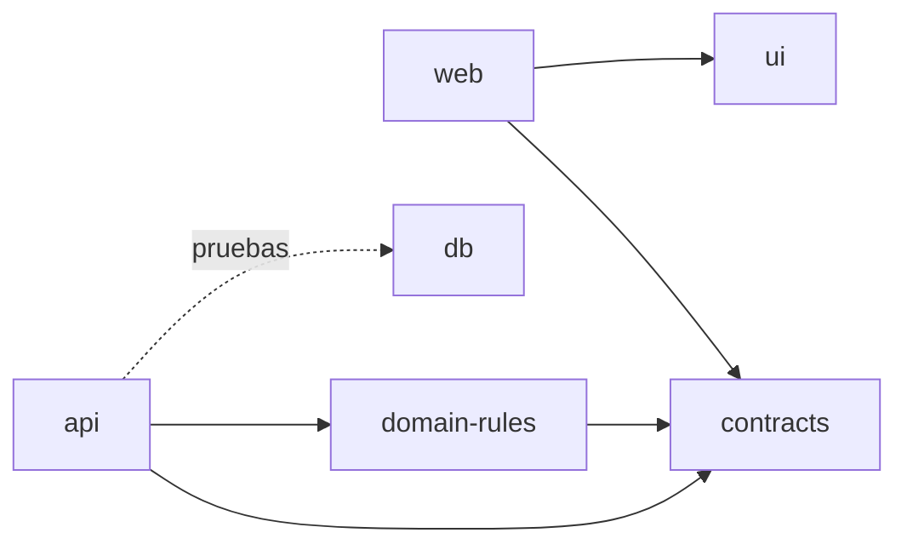

# Arquitectura: visión general

> **Estado: Implementado (1.0-b.1).** Describe solo lo que existe hoy. Lo que viene después está en [`planned-design-v1.md`](planned-design-v1.md) (**Planificado**).

## Forma

Monolito modular en un monorepo de pnpm ([ADR 0002](../adr/0002-modular-monolith-and-stack.md)):

```text
apps/
  api/        NestJS 12: módulos health, identity, tenancy, audit y time-tracking
  web/        React 19 + Vite 8: acceso y sesiones
packages/
  contracts/     Zod: tipos y esquemas compartidos (sin lógica)
  domain-rules/  Reglas puras y deterministas (sin infraestructura)
  ui/            Tokens de marca
db/              Migraciones SQL, bootstrap del rol y base efímera de pruebas
infra/           docker compose (PostgreSQL 18) para desarrollo local
```

La landing pública vive en la raíz y no forma parte de la aplicación ([ADR 0008](../adr/0008-public-repo-landing-at-root-license-pending.md)).

## Dependencias permitidas



- `contracts` no depende de nadie. `domain-rules` solo de `contracts`.
- La web nunca importa reglas de dominio ni accede a la base.

## Capas dentro de un módulo de la API

| Capa              | Contenido                                       | Ejemplo                         |
| ----------------- | ----------------------------------------------- | ------------------------------- |
| `domain/`         | Tipos y puertos del módulo, sin infraestructura | `SessionResolver`, `AuditEntry` |
| `application/`    | Casos de uso; orquesta transacción y auditoría  | `IngestAttendanceEventService`  |
| `infrastructure/` | SQL y adaptadores                               | `AttendanceEventRepository`     |
| `presentation/`   | Controladores y guards; sin reglas de negocio   | `TenantGuard`, controladores    |

Las reglas puras (hash, clasificación, tiempos, precedencia) están en `@puntuale/domain-rules`, no en los servicios.

## Flujo de una petición de empresa

```mermaid
sequenceDiagram
  participant C as Cliente
  participant G as TenantGuard
  participant S as SessionResolver
  participant A as TenantAccessService
  participant DB as PostgreSQL (RLS)
  C->>G: GET /api/t/:tenantId/...
  G->>S: resolve(request)
  S-->>G: null → 401
  G->>A: resolve(tenantId, userId)
  A->>DB: BEGIN; set_config('app.tenant_id', tenantId, true); SELECT membresía
  DB-->>A: sin fila → 404
  A-->>G: TenantContext
  G-->>C: controlador con el contexto validado
```

## Datos y seguridad

- Antes de los controladores corren dos guards globales en `/api/`: `RateLimitGuard` y `CsrfGuard`. `SessionResolver` lo implementa la cookie de sesión del módulo `identity` ([ADR 0014](../adr/0014-postgres-sessions-and-login.md)).
- Dos conexiones: la administrativa solo migra; la API usa `puntuale_app`, sujeta a RLS ([modelo de datos](../data-model/README.md), [seguridad](../security/README.md)).
- Toda escritura ocurre en `withTenant` y se audita en esa misma transacción ([reglas de negocio](../business-rules/)).

## Pruebas

| Nivel       | Comando                 | Docker | Dónde                                                |
| ----------- | ----------------------- | ------ | ---------------------------------------------------- |
| Unitarias   | `pnpm check`            | No     | `src/**/*.test.ts` de cada paquete                   |
| Integración | `pnpm test:integration` | Sí     | `db/test/integration/`, `apps/api/test/integration/` |
| E2E (API)   | `pnpm test:e2e`         | Sí     | `apps/api/test/e2e/`                                 |
