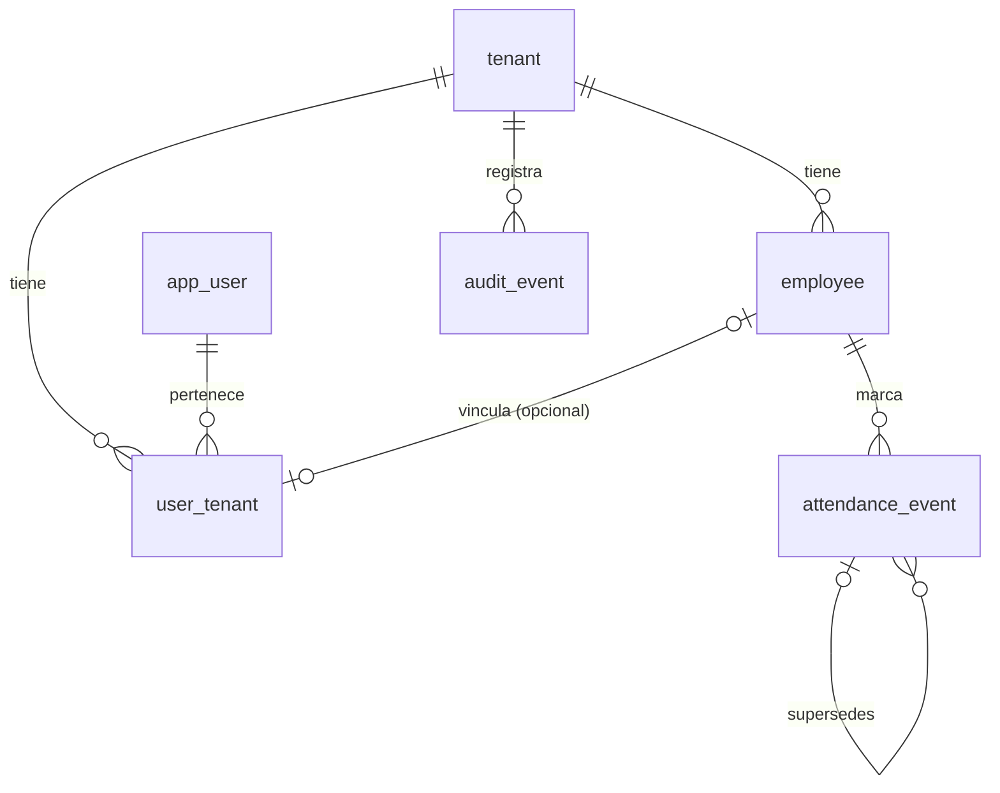

# Modelo de datos

> **Estado: Implementado (1.0-a).** Describe solo la migración `0001_base_multitenant`. Las tablas futuras (calendarios, periodos, jornadas, incidencias, cierres) están en [`../architecture/planned-design-v1.md`](../architecture/planned-design-v1.md) como **Planificado**.

## Diagrama

## Tablas

| Tabla              | Tenant | RLS          | Permisos de `puntuale_app` | Notas                                                                  |
| ------------------ | ------ | ------------ | -------------------------- | ---------------------------------------------------------------------- |
| `tenant`           | `id`   | ENABLE+FORCE | `SELECT`                   | Una empresa (razón social), con su zona IANA                           |
| `app_user`         | —      | No (global)  | `SELECT`                   | Identidad global; el email es `citext` único                           |
| `user_tenant`      | Sí     | ENABLE+FORCE | `SELECT, INSERT, UPDATE`   | Membresía `active`/`revoked`; `employee_id` opcional y único           |
| `employee`         | Sí     | ENABLE+FORCE | `SELECT, INSERT, UPDATE`   | Mínimo (E1). **Sin `DELETE`**: baja lógica con `status = 'terminated'` |
| `attendance_event` | Sí     | ENABLE+FORCE | `SELECT, INSERT`           | Solo inserción (trigger). Idempotencia por `client_event_id`           |
| `audit_event`      | Sí     | ENABLE+FORCE | `SELECT, INSERT`           | Solo inserción (trigger). `id` global con huecos; expone `public_id`   |
| `schema_migration` | —      | —            | Ninguno                    | Control de migraciones (solo la conexión administrativa)               |

Todos los `id` son UUIDv7 generados por la base (`uuidv7()`), salvo `audit_event.id` (`bigint` identity).

## `attendance_event`: campos de tiempo (ADR 0010, ADR 0011)

| Campo                         | Tipo          | Confiable | Uso                                            |
| ----------------------------- | ------------- | --------- | ---------------------------------------------- |
| `declared_local_time`         | `timestamp`   | No        | Evidencia: hora de pared del dispositivo       |
| `declared_utc_offset_minutes` | `smallint`    | No        | Evidencia: resuelve horas ambiguas             |
| `declared_timezone`           | `text` (IANA) | No        | Evidencia                                      |
| `occurred_at_utc`             | `timestamptz` | No        | Derivada; **ordena** las marcaciones           |
| `device_sent_at`              | `timestamptz` | No        | Transporte; sirve para el desfase              |
| `received_at`                 | `timestamptz` | **Sí**    | Hora del servidor; **referencia de auditoría** |
| `clock_offset_seconds`        | `integer`     | —         | `received_at − device_sent_at`                 |

## Restricciones relevantes

- **Colaboradores sin borrado físico.** `puntuale_app` no tiene `DELETE` sobre `employee`, y las FK `attendance_event_employee_fk` y `user_tenant_employee_fk` son `ON DELETE RESTRICT`: ni la conexión administrativa puede borrar a un colaborador con marcaciones o membresía.
- **`received_at`** lo fija la base de datos (`statement_timestamp()`), nunca el dispositivo ([ADR 0010](../adr/0010-time-and-language.md)).

- `attendance_event_utc_consistency`: `occurred_at_utc = (declared_local_time − offset) AT TIME ZONE 'UTC'` cuando hay hora declarada.
- Pares obligatorios: hora local ↔ desfase; `device_sent_at` ↔ `clock_offset_seconds`; `client_event_id` ↔ `payload_hash`.
- `source = 'pwa'` exige `ingest_mode`, hora declarada y `client_event_id`, y no admite `supersedes_event_id`.
- `source = 'correction'` exige `created_by_user_id` y no admite `ingest_mode`.
- Índice único parcial `(tenant_id, client_event_id) WHERE client_event_id IS NOT NULL`.
- `audit_event_user_actor`: si `actor_type = 'user'`, `actor_user_id` es obligatorio.
- `metadata` debe ser un objeto JSON.

## Funciones y triggers

| Nombre                   | Tipo    | Efecto                                                              |
| ------------------------ | ------- | ------------------------------------------------------------------- |
| `app_current_tenant()`   | Función | Lee `app.tenant_id`; `NULL` si falta o no es UUID (falla cerrada)   |
| `reject_mutation()`      | Trigger | Rechaza `UPDATE`, `DELETE` y `TRUNCATE` en tablas de solo inserción |
| `reject_tenant_change()` | Trigger | Rechaza cambiar `tenant_id` en `employee` y `user_tenant`           |
