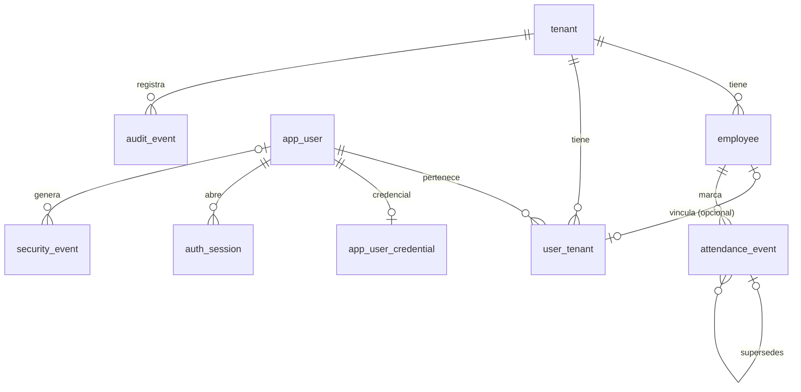

# Modelo de datos

> **Estado: Implementado (1.0-b.1).** Describe las migraciones `0001_base_multitenant` y `0002_sessions_security`. Las tablas futuras (calendarios, periodos, jornadas, incidencias, cierres) están en [`../architecture/planned-design-v1.md`](../architecture/planned-design-v1.md) como **Planificado**.

## Diagrama

## Tablas

| Tabla                   | Tenant | RLS          | Permisos de `puntuale_app`                           | Notas                                                                                |
| ----------------------- | ------ | ------------ | ---------------------------------------------------- | ------------------------------------------------------------------------------------ |
| `tenant`                | `id`   | ENABLE+FORCE | `SELECT`                                             | Una empresa (razón social), con su zona IANA                                         |
| `app_user`              | —      | No (global)  | Ninguno                                              | Identidad global; el email es `citext` único. Se lee con funciones `auth_*`          |
| `user_tenant`           | Sí     | ENABLE+FORCE | `SELECT, INSERT, UPDATE`                             | Membresía `active`/`revoked`; `employee_id` opcional y único                         |
| `employee`              | Sí     | ENABLE+FORCE | `SELECT, INSERT, UPDATE`                             | Mínimo (E1). **Sin `DELETE`**: baja lógica con `status = 'terminated'`               |
| `attendance_event`      | Sí     | ENABLE+FORCE | `SELECT, INSERT`                                     | Solo inserción (trigger). Idempotencia por `client_event_id`                         |
| `audit_event`           | Sí     | ENABLE+FORCE | `SELECT, INSERT`                                     | Solo inserción (trigger). `id` global con huecos; expone `public_id`                 |
| `app_user_credential`   | —      | No (global)  | Ninguno                                              | Hash Argon2id y estado `active`/`disabled`                                           |
| `auth_session`          | —      | No (global)  | `SELECT, INSERT`; `UPDATE` de actividad y revocación | Solo guarda el SHA-256 del token                                                     |
| `security_event`        | —      | No (global)  | `INSERT`                                             | Solo inserción (trigger). Sin correo, contraseña ni token                            |
| `login_failure_account` | —      | No (global)  | `SELECT, INSERT`                                     | Fallos recientes por cuenta; llave HMAC                                              |
| `login_failure_ip`      | —      | No (global)  | `SELECT, INSERT`                                     | Fallos recientes por IP; llave HMAC. Un login exitoso no borra los de otros intentos |
| `rate_limit_bucket`     | —      | No (global)  | `SELECT, INSERT, UPDATE`                             | Contadores por minuto; llaves HMAC                                                   |
| `schema_migration`      | —      | —            | Ninguno                                              | Control de migraciones (solo la conexión administrativa)                             |

Todos los `id` son UUIDv7 generados por la base (`uuidv7()`), salvo `audit_event.id` (`bigint` identity).

## `attendance_event`: campos de tiempo (ADR 0010, ADR 0011)

| Campo                         | Tipo          | Confiable | Uso                                            |
| ----------------------------- | ------------- | --------- | ---------------------------------------------- |
| `declared_local_time`         | `timestamp`   | No        | Evidencia: hora de pared del dispositivo       |
| `declared_utc_offset_minutes` | `smallint`    | No        | Evidencia: resuelve horas ambiguas             |
| `declared_timezone`           | `text` (IANA) | No        | Evidencia                                      |
| `occurred_at_utc`             | `timestamptz` | No        | Derivada; **ordena** las marcaciones           |
| `device_sent_at`              | `timestamptz` | No        | Transporte; sirve para el desfase              |
| `received_at`                 | `timestamptz` | **Sí**    | Hora del servidor; **referencia de auditoría** |
| `clock_offset_seconds`        | `integer`     | —         | `received_at − device_sent_at`                 |

## Restricciones relevantes

- **Colaboradores sin borrado físico.** Un colaborador se da de baja con `status = 'terminated'` y sigue consultable como histórico, con sus marcaciones y su membresía. Tres barreras:
  - `puntuale_app` no tiene `DELETE` ni `TRUNCATE` sobre `employee`;
  - los triggers `employee_reject_delete` y `employee_reject_truncate` rechazan el borrado de cualquier rol en el flujo normal, incluida la conexión administrativa ordinaria y aunque el colaborador no tenga referencias;
  - las FK `attendance_event_employee_fk` y `user_tenant_employee_fk` son `ON DELETE RESTRICT`.

  Un bypass deliberado de un superusuario solo se admite con el [procedimiento de emergencia](../operations/emergency-changes.md).

- **`received_at`** lo fija la base de datos (`statement_timestamp()`), nunca el dispositivo ([ADR 0010](../adr/0010-time-and-language.md)).

- `attendance_event_utc_consistency`: `occurred_at_utc = (declared_local_time − offset) AT TIME ZONE 'UTC'` cuando hay hora declarada.
- Pares obligatorios: hora local ↔ desfase; `device_sent_at` ↔ `clock_offset_seconds`; `client_event_id` ↔ `payload_hash`.
- `source = 'pwa'` exige `ingest_mode`, hora declarada y `client_event_id`, y no admite `supersedes_event_id`.
- `source = 'correction'` exige `created_by_user_id` y no admite `ingest_mode`.
- Índice único parcial `(tenant_id, client_event_id) WHERE client_event_id IS NOT NULL`.
- `audit_event_user_actor`: si `actor_type = 'user'`, `actor_user_id` es obligatorio.
- `metadata` debe ser un objeto JSON.

## Funciones y triggers

| Nombre                                        | Tipo               | Efecto                                                                             |
| --------------------------------------------- | ------------------ | ---------------------------------------------------------------------------------- |
| `app_current_tenant()`                        | Función            | Lee `app.tenant_id`; `NULL` si falta o no es UUID (falla cerrada)                  |
| `reject_mutation()`                           | Trigger            | Rechaza `UPDATE`, `DELETE` y `TRUNCATE` en tablas de solo inserción                |
| `reject_tenant_change()`                      | Trigger            | Rechaza cambiar `tenant_id` en `employee` y `user_tenant`                          |
| `reject_employee_delete()`                    | Trigger            | Rechaza `DELETE` y `TRUNCATE` en `employee` (baja lógica)                          |
| `auth_find_account(text)`                     | `SECURITY DEFINER` | Devuelve `user_id` y hash de una cuenta activa, por correo; sin filas si no existe |
| `auth_session_identity(text)`                 | `SECURITY DEFINER` | Devuelve la identidad de una sesión activa, por hash del token                     |
| `auth_clear_login_failures(text)`             | `SECURITY DEFINER` | Borra los fallos de una cuenta tras un login exitoso                               |
| `auth_release_login_ip_attempt(bigint, text)` | `SECURITY DEFINER` | Retira de la IP solo el intento de un login con contraseña correcta                |
| `auth_purge_throttle()`                       | `SECURITY DEFINER` | Borra fallos y contadores vencidos                                                 |

Las funciones `auth_*` pertenecen a `puntuale_auth_definer` (`NOLOGIN`, sin superusuario, sin `BYPASSRLS`), con `search_path` fijo y `EXECUTE` solo para `puntuale_app` ([ADR 0014](../adr/0014-postgres-sessions-and-login.md)). `auth_session` y `security_event` son globales: una sesión identifica a una persona, no a una empresa.
