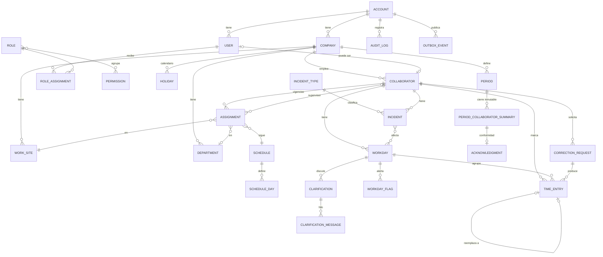

> **Estado: Histórico.** Esta es la propuesta original del 7 de noviembre de 2026. Varias de sus decisiones cambiaron tras la revisión arquitectónica (tenant = empresa, cuatro estados con nombres en inglés, calendarios de periodo, modo sin conexión, licencia pendiente). Las decisiones vigentes están en [`docs/adr/`](../adr/) y el diseño planificado en [`docs/architecture/planned-design-v1.md`](../architecture/planned-design-v1.md). Este archivo no se actualiza.

# Puntuale · Diagnóstico y propuesta técnica para la versión 1

> Estado: **propuesta con decisiones tomadas** (ver §7.1). No se ha implementado nada nuevo.
> Fecha: 7 de noviembre de 2026.
> Alcance: versión 1.x (control de asistencia). La versión 2.x (nómina) solo se considera para no cerrarle el paso.

---

## 1. Diagnóstico del proyecto actual

### 1.1 Inventario

**`C:\proyectos\TA-2027\`**

| Ruta | Contenido |
|---|---|
| `puntuale_landingpage/index.html` | Landing de una sola página (12 KB): hero, demo interactiva de registro, tabla de periodo, “Cómo funciona”, FAQ, cierre y pie. |
| `puntuale_landingpage/styles.css` | 13.7 KB de CSS sin compilar, escrito en una línea por regla. Tiene tokens en `:root` y tres breakpoints (1050, 760 y 380 px). |
| `puntuale_landingpage/script.js` | 3.3 KB. Máquina de 3 estados para la demo (sin registro → entrada → salida) y filtro “Todos / Por revisar”. |
| `puntuale_landingpage/assets/` | `logo.png` (2172×724, 341 KB) e `isotipo.png` (72 KB). |
| `puntuale_landingpage/.github/workflows/pages.yml` | Despliegue a GitHub Pages que publica la carpeta completa (`path: '.'`). |
| `puntuale_landingpage/README.md`, `.nojekyll` | Documentación y archivo para desactivar Jekyll. |
| `puntuale_landingpage/puntuale-github-pages.zip` | Copia comprimida de la misma landing. |

**Material de referencia, fuera del repositorio** (`Documents\ChatGPT\Control Asistencia 2027\`)

| Ruta | Contenido |
|---|---|
| `kit de indentidad/` | Kit de identidad, logo principal e isotipo (PNG y JPG). |
| `branding/` | Mismo logo principal (idéntico byte a byte). |
| `Referencias/01 Decreto DOF…2027.pdf` | DOF del 1 de mayo de 2026 con la reforma a la LFT (reducción de jornada y registro electrónico). |
| `Referencias/02 Ley Federal del Trabajo.pdf` | LFT vigente, última reforma DOF 14-05-2026. |
| `Referencias/03`, `04` y `05` (`.html`) | **Los tres son el mismo archivo**: una página de error del DOF que dice “Su solicitud no pudo ser procesada correctamente”. No contienen la LFPDPPP, el Reglamento Federal de Seguridad y Salud en el Trabajo ni la NOM-037. |
| `build_workflow_diagram.py` y `output/pdf/TA-2027.pdf` | Flujo de trabajo del equipo: Tú (Product Owner) → ChatGPT (arquitecto) → Claude Code (implementa y hace commits) → Codex (audita sin modificar) → Tú (apruebas). |

La carpeta del proyecto **todavía no es un repositorio git**.

### 1.2 Hallazgos en la landing

**Lo que está bien hecho**

- Es HTML semántico y accesible: enlace para saltar al contenido, `aria-live` en la retroalimentación de la demo, `aria-pressed` en los filtros, `caption` y `scope` en la tabla, `:focus-visible`, `prefers-reduced-motion` y la clase `sr-only`.
- Es responsivo hasta 380 px y la tabla se desplaza horizontalmente con foco de teclado.
- El texto es cuidadoso con el alcance: aclara que no calcula la nómina, que “Completo” no valida la jornada y que los datos son ficticios. Esto encaja exactamente con el límite de la versión 1.
- Los tokens de color coinciden con el kit (`#0F2C52`, `#1769AA`, `#EAF3FB`, `#F3F5F7`, `#202124`).

**Problemas a corregir (ninguno bloquea la versión 1)**

1. **El ZIP se publica.** `pages.yml` sube la carpeta completa, así que `puntuale-github-pages.zip` (355 KB) queda descargable en el sitio público.
2. **Las imágenes del logo son pesadas.** `logo.png` pesa 341 KB a 2172×724 y se muestra a 290 px o menos. Se usa cuatro veces (llega cacheado, pero el primer pintado es lento). No hay SVG.
3. **El favicon es un PNG de 72 KB** y faltan los tamaños que pide el kit (16, 32, 64, 180 y 512 px), además del `manifest`.
4. **Montserrat se carga desde Google Fonts.** Para una plataforma con datos personales conviene autoalojar la fuente: evita transferir la IP del visitante a un tercero y quita una dependencia externa.
5. **`--ink` (#202124) está declarado pero no se usa.** El texto principal usa `--navy`. Hay que decidir cuál es el color de texto oficial en la app.
6. **Solo hay dos estados de registro** (`complete` y `pending`, con las etiquetas “Completo”, “Falta salida”, “En curso” y “Sin registros”). La versión 1 necesita cuatro estados con colores semánticos que el kit no define (ver §6).
7. **El cache-busting es manual** (`?v=revision-4`).
8. **El CSS está escrito en una línea por regla**, lo que dificulta revisarlo y compararlo en un diff. No es grave en una landing, pero no debe trasladarse así a la app.

### 1.3 Hallazgos en las referencias legales (impactan el diseño)

Del **decreto DOF del 1 de mayo de 2026** y de la LFT vigente:

- **Art. 132, fr. XXXIV:** el patrón debe *registrar de manera electrónica la jornada de cada persona trabajadora, incluido el horario de inicio y finalización*, y entregarlo a la autoridad cuando lo requiera.
- El registro electrónico **“hará prueba plena si se acredita que fue acordado entre la persona trabajadora y empleadora”**. Esto implica que el sistema debe poder mostrar que el colaborador aceptó su registro (conformidad).
- **Quinto transitorio:** las disposiciones de carácter general de la STPS sobre ese registro **entran en vigor el 1 de enero de 2027**. Todavía no están en las referencias y pueden fijar formato, conservación o exportación. Es el principal riesgo de requisitos.
- **Art. 994, fr. IV Bis:** el incumplimiento tiene una multa de 250 a 5,000 UMA. Esto le da peso al argumento de venta y a la auditoría.
- **Límites de jornada:**
  - Diaria: 8 h diurna, 7 h nocturna y 7.5 h mixta.
  - Semanal: 48 h en 2026, **46 h en 2027**, 44, 42 y 40 h en los años siguientes.
  - Tiempo extraordinario: 9 h por semana en 2027, en hasta 4 h diarias y un máximo de 4 días.
  - Suma de jornada ordinaria y extraordinaria: 12 h diarias como máximo.
  - Descanso: 1 día por cada 6 de trabajo.

  Estas reglas pueden usarse en la versión 1 **solo como alertas de revisión, sin calcular pagos** (ver la decisión D9).

**Faltan documentos:** hay que volver a descargar la LFPDPPP, el RFSST y la NOM-037-STPS-2023. La NOM-037 de teletrabajo importa si se permitirá registrar desde casa.

---

## 2. Arquitectura técnica propuesta

### 2.1 Principios

1. **Monolito modular.** Un solo backend y una sola base de datos, con módulos de dominio separados por fronteras explícitas. Es más simple de operar que los microservicios y permite agregar `payroll` en la versión 2 como un módulo nuevo, sin tocar el núcleo.
2. **Los registros de entrada y salida son inmutables.** Nunca se editan ni se borran: una corrección crea un registro nuevo que reemplaza al anterior y conserva el vínculo.
3. **La jornada se deriva de las marcaciones.** El estado (completo, pendiente, incompleto o por revisar) se calcula a partir de las marcaciones, el horario y las incidencias. No se escribe a mano.
4. **El periodo cerrado es el contrato con la versión 2.** Al cerrar un periodo de revisión se genera un resumen inmutable. Ese resumen es lo único que la nómina consumirá.
5. **Multiempresa desde el día 1**, con aislamiento por inquilino en cada consulta y *Row Level Security* de PostgreSQL como segunda barrera.
6. **Auditoría como parte del dominio**, no como un log técnico.

### 2.2 Stack recomendado

| Capa | Recomendación | Por qué |
|---|---|---|
| Lenguaje | **TypeScript** en todo el proyecto | Comparte tipos y validaciones entre el frontend y la API. |
| API | **NestJS** (Node 22 LTS) | Tiene módulos, inyección de dependencias, guards para roles y pruebas. Sus módulos encajan con el monolito modular. |
| Base de datos | **PostgreSQL 16** | Es relacional y transaccional. Ofrece `timestamptz`, `jsonb` para la auditoría, RLS y restricciones de exclusión para periodos. |
| Acceso a datos | **Drizzle ORM** con migraciones SQL versionadas | El SQL es explícito y se lleva bien con RLS y restricciones avanzadas. |
| Validación y contratos | **Zod** en un paquete compartido | La misma regla valida en el formulario y en la API. |
| Web app | **React + Vite + TanStack Router y Query** | Es una SPA para administración y revisión, con la vista del colaborador como **PWA** instalable en el celular. |
| Estilos | **CSS con tokens propios** (CSS Modules), derivados de la landing | Conserva la identidad sin un framework que la diluya. |
| Autenticación | Sesiones con cookie `httpOnly`, contraseñas con Argon2id y MFA (TOTP) para administradores | Ver la decisión D2. |
| Tareas programadas | `pg-boss` (cola sobre PostgreSQL) | Cierra jornadas vencidas, recalcula estados y envía avisos sin otra infraestructura. |
| Eventos internos | Patrón *outbox* en PostgreSQL | Publica `JornadaCerrada`, `PeriodoCerrado`, etc. Es el punto de enganche de la versión 2. |
| Pruebas | Vitest (unitarias), Testcontainers con PostgreSQL (integración) y Playwright (end-to-end) | |
| Monorepo | **pnpm workspaces + Turborepo** | |
| Infraestructura local | Docker Compose (PostgreSQL y Mailpit) | |

**Alternativa más ligera** si se busca salir al mercado antes: Supabase (PostgreSQL gestionado con autenticación y RLS) y la misma web app en React. Reduce el backend propio, pero acopla la lógica de estados y auditoría a funciones de base de datos y complica la versión 2. No la recomiendo como base definitiva.

### 2.3 Diagrama lógico

```
┌──────────────┐  ┌───────────────────────────────┐
│ Landing      │  │ Web app (React PWA)           │
│ (estática)   │  │  · Colaborador: registrar,    │
│ GitHub Pages │  │    ver jornada, aclarar       │
└──────────────┘  │  · Supervisor/RH: revisar día │
                  │    y periodo, corregir,       │
                  │    reportes                   │
                  └──────────────┬────────────────┘
                                 │ HTTPS/JSON (cookie de sesión)
┌────────────────────────────────▼────────────────────────────────┐
│ API · NestJS (monolito modular)                                  │
│ identity · organization · collaborators · schedules              │
│ time-tracking · workdays · periods · incidents · corrections     │
│ reports · audit · notifications            [v2: payroll ⟵ eventos]│
│ shared: tenancy, auth guards, outbox, jobs                       │
└────────────────────────────────┬────────────────────────────────┘
                                 │
                         ┌───────▼───────┐
                         │ PostgreSQL    │  RLS por tenant
                         │ + pg-boss     │  outbox / audit
                         └───────────────┘
```

---

## 3. Estructura de carpetas propuesta

```
TA-2027/
├── apps/
│   ├── landing/                 # la landing actual, movida aquí (ver decisión D12)
│   ├── web/                     # React + Vite (PWA)
│   │   └── src/
│   │       ├── app/             # rutas, layout, providers
│   │       ├── features/        # una carpeta por módulo de dominio
│   │       │   ├── auth/  clock-in/  workdays/  review/  periods/
│   │       │   ├── incidents/  corrections/  collaborators/
│   │       │   ├── reports/  audit/  settings/
│   │       └── shared/          # api client, hooks, utilidades
│   └── api/                     # NestJS
│       └── src/
│           ├── modules/
│           │   ├── identity/        # usuarios, sesiones, roles, permisos
│           │   ├── organization/    # cuentas, empresas, centros, áreas
│           │   ├── collaborators/
│           │   ├── schedules/       # horarios, turnos, calendario
│           │   ├── time-tracking/   # marcaciones (append-only)
│           │   ├── workdays/        # jornadas y cálculo de estado
│           │   ├── periods/         # periodos de revisión y cierre
│           │   ├── incidents/       # incidencias y aclaraciones
│           │   ├── corrections/     # solicitudes de corrección
│           │   ├── reports/
│           │   ├── audit/
│           │   └── notifications/
│           │   # (payroll/ se crea en la v2; NO existe en la v1)
│           │   # cada módulo: domain/ application/ infrastructure/ http/
│           ├── shared/          # db, tenancy, guards, outbox, jobs, errores
│           └── main.ts
├── packages/
│   ├── ui/                      # tokens.css + componentes con la identidad Puntuale
│   ├── contracts/               # esquemas Zod y tipos de la API (compartidos)
│   ├── domain-rules/            # reglas puras: estados de jornada, límites LFT
│   └── config/                  # tsconfig, eslint, prettier
├── db/
│   └── migrations/              # SQL versionado
├── infra/
│   └── docker-compose.yml
├── docs/
│   ├── propuesta-tecnica-v1.md  # este documento
│   ├── adr/                     # decisiones de arquitectura numeradas
│   └── referencias-legales.md   # resumen y enlaces (no los PDF)
├── .github/workflows/           # CI de app + despliegue de landing
├── package.json  pnpm-workspace.yaml  turbo.json
└── README.md
```

**Regla de dependencias:** un módulo solo usa otro a través de su servicio público (`application/`) o de eventos. Nunca accede directamente a sus tablas. `domain-rules` no depende de nada, así que se puede probar sin base de datos.

---

## 4. Módulos principales

| # | Módulo | Responsabilidad en la versión 1 | Fuera de la versión 1 |
|---|---|---|---|
| 1 | **identity** | Usuarios, inicio de sesión, MFA, sesiones, roles, permisos y alcance (empresa, centro, área o equipo). | SSO corporativo (posible 1.x). |
| 2 | **organization** | Cuenta cliente (tenant), empresas (razones sociales), centros de trabajo, áreas, zona horaria y configuración. | Registro patronal, datos fiscales (v2). |
| 3 | **collaborators** | Alta, baja y edición de colaboradores con asignación vigente por fechas (centro, área, horario y supervisor). | Salario, banco, NSS y datos de nómina (v2). |
| 4 | **schedules** | Horarios y turnos (diurna, nocturna o mixta), días de descanso, días festivos y tolerancias. | — |
| 5 | **time-tracking** | Marcaciones de entrada y salida (app, kiosco o manual), con origen, dispositivo y ubicación opcional. Sin edición ni borrado. | Biométricos (ver D3). |
| 6 | **workdays** | Construir la jornada del día a partir de las marcaciones y calcular su estado y sus minutos registrados. | Clasificar horas como pagables. |
| 7 | **periods** | Periodos de revisión (semanal, catorcenal, quincenal o mensual), revisión del periodo, cierre y reapertura con motivo, resumen inmutable y conformidad del colaborador. | El periodo de nómina en sí (v2 lo enlaza). |
| 8 | **incidents** | Incidencias (falta, retardo, salida anticipada, permiso, vacaciones, incapacidad u otras) y aclaraciones en hilo entre el colaborador y el revisor. | Saldos de vacaciones con efecto económico, efecto en el pago. |
| 9 | **corrections** | Solicitud de corrección (agregar, ajustar o anular una marcación), con aprobación, motivo, evidencia e historial completo. | — |
| 10 | **reports** | Asistencia por periodo, pendientes, incidencias, correcciones y horas registradas contra las esperadas. **Reporte de incidencias para nómina** por periodo cerrado: el entregable principal para que el cliente prepare su nómina por fuera. Exportación a CSV, XLSX y PDF. | Cualquier importe, costo o cálculo de dinero. |
| 11 | **audit** | Bitácora inmutable de cada cambio (quién, qué, antes y después, motivo, IP y fecha), consultable y exportable. | — |
| 12 | **notifications** | Avisos dentro de la app y por correo (marcación faltante, aclaración respondida, periodo por cerrar). | WhatsApp o SMS (1.x). |

### 4.1 Estados de asistencia (propuesta, por confirmar en D5)

Se calculan por jornada (colaborador + fecha de inicio del turno) con esta precedencia:

| Estado | Regla propuesta | Color propuesto |
|---|---|---|
| **Pendiente** | La jornada está en curso o su ventana todavía no vence, así que aún puede completarse sola. | Ámbar (el `pending` actual: `#79571B` sobre `#FAF3E7`) |
| **Incompleto** | La ventana ya cerró y falta una marcación (sin entrada, sin salida o pares impares), sin una incidencia que lo justifique. | Rojo atenuado (nuevo) |
| **Por revisar** | Las marcaciones están completas, pero algo requiere a una persona: corrección o aclaración abierta, desviación del horario mayor a la tolerancia, alerta de límite legal, registro manual o fuera de la ubicación esperada. | Azul profesional (`#1769AA` sobre `#EAF3FB`) |
| **Completo** | Tiene entrada y salida y no hay nada pendiente. | Verde (el `complete` actual: `#285D46` sobre `#EDF5F0`) |

El **estado de revisión** es una dimensión aparte: *sin revisar*, *revisado* o *aprobado en el cierre*. “Completo” solo describe los datos, no significa “aprobado”, como ya lo aclara la landing.

### 4.2 Roles base

| Rol | Alcance típico | Puede |
|---|---|---|
| Administrador de cuenta | Toda la cuenta | Todo, incluida la configuración, los usuarios y los roles. |
| RH o revisor | Una o varias empresas | Revisar, corregir, cerrar y reabrir periodos, ver reportes y gestionar colaboradores. |
| Supervisor | Su área, centro o equipo | Revisar el día, responder aclaraciones, proponer o aprobar correcciones (según la configuración) y ver reportes de su alcance. |
| Colaborador | Solo él mismo | Registrar, ver sus jornadas, pedir aclaraciones o correcciones y dar conformidad al periodo. |
| Auditor | Solo lectura | Consultar registros, bitácora y reportes. |
| Soporte Puntuale | Plataforma | Acceso de soporte con el permiso del cliente y auditado. |

Los permisos son granulares (`workday.review`, `correction.approve`, `period.close`…) y los roles son paquetes de permisos. Así la versión 2 agrega `payroll.*` sin cambiar el modelo.

---

## 5. Entidades de datos y relaciones

Convenciones:

- Identificadores UUIDv7.
- Todas las tablas de negocio llevan `account_id` (tenant) y, cuando aplica, `company_id`.
- Las fechas y horas se guardan en `timestamptz` (UTC), con la zona horaria del centro de trabajo.
- La fecha de la jornada (`work_date`) es la fecha local en que **inicia** el turno, para que los turnos nocturnos no se partan.
- La duración se guarda en minutos enteros.
- En la versión 1 no existe ningún campo monetario.



### 5.1 Entidades principales

| Entidad | Campos clave | Notas |
|---|---|---|
| `account` | nombre, plan y estado | Es el tenant: el cliente que contrata Puntuale. |
| `company` | `account_id`, razón social, nombre comercial, RFC (opcional en v1), zona horaria y configuración | Es el **patrón legal**. Separarlo de `account` permite grupos con varias razones sociales y la nómina por empresa en la v2. |
| `work_site` | `company_id`, nombre, dirección, zona horaria y geocerca opcional | Es el centro de trabajo. |
| `department` | `company_id`, nombre y `parent_id` | |
| `user` | correo, hash de la contraseña, MFA y estado | Es una persona que inicia sesión. Puede o no ser colaborador. |
| `role`, `permission`, `role_assignment` | `role_assignment` guarda el usuario, el rol y el alcance (`scope_type`: cuenta, empresa, centro o área, más `scope_id`) | |
| `collaborator` | `company_id`, número de empleado, nombre, correo y teléfono, fecha de ingreso y de baja, estado y `user_id` opcional | **Es la entidad que comparten la v1 y la v2.** En la v1 solo lleva los datos necesarios para la asistencia. |
| `assignment` | `collaborator_id`, centro, área, horario, supervisor, `valid_from` y `valid_to` | Registra el historial de cambios por fecha. La v2 lo usa para saber qué regía en cada periodo. |
| `schedule` y `schedule_day` | Tipo de jornada (diurna, nocturna o mixta), días, hora de entrada y salida, pausas y tolerancias | |
| `holiday` | `company_id`, fecha y descripción | |
| `time_entry` | `collaborator_id`, `kind` (entrada o salida), `occurred_at`, `source` (app, kiosco, manual o corrección), dispositivo, ubicación opcional, `supersedes_id`, `voided`, `correction_request_id` y `recorded_by` | **Se agrega pero nunca se modifica.** El valor efectivo es el último registro de la cadena que no fue anulado. |
| `workday` | `collaborator_id`, `work_date`, `schedule_snapshot`, primera entrada, última salida, minutos registrados y esperados, `status`, `review_status` y `period_id` | Es una proyección que se recalcula. Se guarda para poder consultar rápido. |
| `workday_flag` | `workday_id` y código (`LATE`, `EARLY_LEAVE`, `DAILY_LIMIT`, `WEEKLY_LIMIT`, `OUTSIDE_GEOFENCE`, `MANUAL_ENTRY`…) | Son los motivos por los que una jornada queda “por revisar”. |
| `period` | `company_id`, frecuencia, inicio, fin y estado (abierto, en revisión, cerrado o reabierto) | Una restricción de exclusión impide que se traslapen. |
| `period_collaborator_summary` | `period_id`, `collaborator_id`, días trabajados, minutos registrados y esperados, conteo de incidencias por código, `snapshot jsonb` y hash | **Se escribe una sola vez al cerrar el periodo. Es lo que leerá la v2.** |
| `acknowledgment` | Resumen del periodo, aceptado o con objeción, fecha, IP y comentario | Es la conformidad del colaborador, que sostiene la “prueba plena” del Art. 132 XXXIV. |
| `incident_type` | Código, nombre, si justifica la ausencia, si requiere evidencia y si es de sistema o del cliente | Es un catálogo. **No tiene campos de pago**: la v2 tendrá su propia tabla que relacione cada código de incidencia con un concepto de nómina. |
| `incident` | Colaborador, tipo, rango de fechas, estado (solicitada, aprobada o rechazada), evidencia y aprobador | |
| `clarification` y `clarification_message` | Jornada o incidencia, estado (abierta o resuelta) y mensajes | |
| `correction_request` | Colaborador, jornada, acción (agregar, ajustar o anular), valor propuesto, motivo, evidencia, estado, solicitante y quien resolvió | Al aprobarse genera registros en `time_entry`. |
| `audit_log` | `account_id`, actor, acción, entidad, `entity_id`, `before` y `after` en jsonb, motivo, IP, user agent, fecha, `prev_hash` y `hash` | Solo admite inserciones (sin permisos de UPDATE o DELETE). Una cadena de hashes permite detectar alteraciones. |
| `outbox_event` | Tipo, carga, fecha y `processed_at` | Ejemplos: `WorkdayStatusChanged`, `PeriodClosed`, `PeriodReopened`, `CollaboratorTerminated`. |

### 5.2 Cómo queda preparada la versión 2 sin rehacer el núcleo

- **Módulo nuevo `payroll/`** con tablas propias (`payroll_period`, `payroll_run`, `payroll_concept`, `incident_concept_map`, `collaborator_payroll_profile`…) que solo **referencian** a `company`, `collaborator`, `period` y `period_collaborator_summary`.
- **El dato sensible de nómina vive aparte.** Salario, NSS, CURP y cuenta bancaria van en `collaborator_payroll_profile` (v2), con permisos `payroll.*` y cifrado de columna. La v1 nunca los guarda.
- **El contrato es el cierre del periodo.** La v2 se suscribe a `PeriodClosed` y lee el resumen inmutable. Si se reabre un periodo, `PeriodReopened` le avisa que debe recalcular.
- **Las incidencias se mapean, no se modifican.** La v2 relaciona cada `incident_type.code` con sus conceptos de nómina en su propia tabla.
- **Las integraciones externas** (proveedores de nómina o timbrado) serán adaptadores dentro de `payroll/infrastructure`, sin tocar los módulos de la v1.
- **Los permisos y la auditoría ya son genéricos**, así que la v2 los reutiliza tal como están.

---

## 6. Elementos reutilizables de la landing

| Elemento de la landing | Uso en la app | Ajuste necesario |
|---|---|---|
| Tokens `:root` (`--navy`, `--blue`, `--pale`, `--gray`, `--muted`, `--line`) | Base de `packages/ui/tokens.css` | Agregar escalas (hover, deshabilitado), colores semánticos (éxito, alerta, error, información), espaciado y radios (3, 4 y 5 px). Definir si el texto es `--ink` o `--navy`. |
| Montserrat 400 a 800 | Tipografía de la app | Autoalojar la fuente en WOFF2 y limitar los pesos a 400, 500, 600 y 700. |
| `.button`, `.button-white`, `.nav-cta`, `.text-link` | Botones primario, secundario e invertido, y enlaces | Agregar los estados de foco, deshabilitado y carga. |
| `.clock-box`, `.clock`, `.clock-status`, `.check-in`, `.activity` | **Pantalla de registro del colaborador.** El diseño de la demo ya lo es. | Conectarla a datos reales y agregar los estados de error, sin conexión y ubicación. |
| `.record-status.complete` y `.pending` | Insignias de estado | Ampliarlas a 4 estados (§4.1) y validar el contraste AA. |
| `.period-panel`, `.period-toolbar`, `.period-controls`, `.filters`, `.table-scroll`, `table` | **Vista de revisión del periodo**, que la landing ya maqueta | Agregar ordenamiento, paginación, selección múltiple y la vista de detalle. |
| `.filters` y `.filter` (control segmentado con `aria-pressed`) | Filtros por estado | — |
| `details` y `summary` (FAQ) | Paneles colapsables y ayuda contextual | — |
| `.preview-footnote` y `.period-note` | Avisos informativos en línea | — |
| `.eyebrow`, `.section-heading`, `.steps` | Encabezados de página y asistentes (por ejemplo, la configuración inicial) | — |
| Accesibilidad: `.skip`, `.sr-only`, `:focus-visible`, `prefers-reduced-motion` y regiones `aria-live` | Se adopta tal cual en la app | — |
| Breakpoints 1050, 760 y 380 px | Punto de partida | La app necesita un layout con navegación lateral en escritorio y navegación inferior en el móvil. |
| `logo.png` e `isotipo.png` | Marca | **Vectorizar a SVG**, generar los favicons y los íconos de PWA (16 a 512 px) y crear la versión monocroma blanca para fondos oscuros (ya está en el kit). |
| Tono del texto (“revisar”, “aclarar”, “una conversación, no una suposición”) | Microcopy de la app | Escribir una guía breve de voz. |
| `script.js` | **No se reutiliza como código.** Manipula el DOM directamente y la app será React. | Se conserva su flujo de estados como referencia funcional. |

---

## 7. Decisiones que deben tomarse antes de programar

| # | Decisión | Recomendación |
|---|---|---|
| **D1** | Stack y hospedaje: ¿el de §2.2? ¿En qué nube y región (México o EE. UU.)? | El stack de §2.2. PostgreSQL gestionado en una región de México si existe y, si no, en EE. UU. con la transferencia declarada en el aviso de privacidad. |
| **D2** | Autenticación propia o un proveedor gestionado (Auth0, Clerk, Cognito) | Propia con sesiones, Argon2id y MFA para administradores. Menos dependencias y costo por usuario activo, y control de la auditoría. |
| **D3** | Métodos de registro en la v1: web/PWA en el celular, kiosco compartido (PIN o QR), geolocalización, foto, biométrico y modo sin conexión | PWA con geolocalización opcional por centro, más kiosco con PIN. **Sin biométricos ni selfie en la v1**: son datos sensibles según la LFPDPPP. Sin conexión: registrar en cola con la hora del dispositivo marcada “por revisar”. |
| **D4** | ¿Los horarios y turnos entran en la v1? No están en la lista de alcance, pero sin ellos no se distingue lo pendiente de lo incompleto. | Sí, en versión mínima: plantillas semanales, tolerancias y descansos. Las rotaciones complejas quedan para la 1.x. |
| **D5** | Definición exacta y precedencia de los 4 estados | Confirmar o ajustar §4.1. |
| **D6** | Frecuencias de periodo y reglas de cierre y reapertura (¿quién reabre? ¿con qué motivo?) | Semanal, catorcenal, quincenal y mensual. Solo RH reabre, con motivo obligatorio y auditado. |
| **D7** | Conformidad del colaborador sobre su registro | **Incluirla en la v1**: aceptar u objetar el periodo. Da soporte a la “prueba plena” del Art. 132 XXXIV. |
| **D8** | Catálogo de incidencias de la v1 | Falta, retardo, salida anticipada, permiso con y sin goce, vacaciones, incapacidad, día festivo trabajado y descanso trabajado, solo como registro y sin efecto económico. |
| **D9** | ¿Alertar sobre límites de la LFT (diario, semanal y extra 2027)? | Sí, como `workday_flag` que lleva la jornada a “por revisar”. Sin clasificar horas como pagables. Los límites se configuran por año. |
| **D10** | Privacidad y conservación de datos: aviso de privacidad, papel de Puntuale como encargado y tiempo de conservación de los registros | Asesoría legal. Conservar los registros por al menos un año tras la baja (referencia del Art. 804 LFT), configurable. Pendiente de lo que fijen las disposiciones de la STPS. |
| **D11** | Modelo de tenant: cuenta → empresas (razones sociales) o una empresa por cuenta | Cuenta → varias empresas, como en §5. Es indispensable para la v2. |
| **D12** | Repositorio: `git init`, monorepo, mover la landing a `apps/landing`, y si se usa el mismo repositorio de GitHub (`echucuan/puntuale`) o uno nuevo | Un solo monorepo privado. La landing se publica desde `apps/landing` con el workflow ajustado y sin el ZIP. |
| **D13** | Idioma del código | Identificadores en inglés y toda la interfaz en español (con i18n preparado). |
| **D14** | Zonas horarias | Una zona horaria por centro de trabajo. México sin horario de verano, excepto los municipios fronterizos. Se guarda en UTC. |
| **D15** | Referencias faltantes | Volver a descargar la LFPDPPP, el RFSST y la NOM-037, y dar seguimiento a la publicación de las disposiciones de la STPS (vigentes desde el 1 de enero de 2027). |
| **D16** | Colores semánticos para “incompleto” y “por revisar” | Proponerlos en `packages/ui` y validarlos con la identidad. |

### 7.1 Decisiones tomadas (7 de noviembre de 2026)

| # | Decisión |
|---|---|
| D1 | **Stack:** NestJS + PostgreSQL + React/Vite (PWA), TypeScript en monorepo, como en §2.2. |
| D2 | **Autenticación propia:** sesiones con cookie `httpOnly`, Argon2id y MFA (TOTP) para los administradores. |
| D3 | **Registro solo desde la PWA en el celular o navegador**, con la sesión del colaborador. En la v1 no hay kiosco, geolocalización, selfie ni biométricos. El modelo de `time_entry` conserva `source` y `device` para agregarlos en la 1.x. |
| D4 | **Horarios mínimos:** plantillas semanales por colaborador, tolerancias, descansos y festivos. Las rotaciones quedan para la 1.x. |
| D5 | **Los cuatro estados de §4.1 se aceptan tal cual.** La aprobación es un estado de revisión aparte. |
| D6 | **Periodos semanal, catorcenal, quincenal y mensual** por empresa. Solo RH reabre un periodo cerrado, con motivo obligatorio y auditado. |
| D7 | **Conformidad por periodo:** al cerrar, el colaborador acepta u objeta su resumen, y la objeción abre una aclaración. |
| D8 | **Catálogo base completo:** falta, retardo, salida anticipada, permiso con y sin goce, vacaciones, incapacidad, festivo trabajado y descanso trabajado. Cada empresa puede agregar los suyos. **Puntuale no maneja dinero:** su salida es el *reporte de incidencias para nómina* por periodo, y el cliente hace la nómina con su propio sistema. |
| D9 | **Alertas de límites de la LFT** (diarios, 46 h semanales en 2027 y 9 h extra), configurables por año. Generan un `workday_flag` y pasan la jornada a “por revisar”, sin clasificar horas pagables. |
| D11 | **Cuenta → varias empresas** (razones sociales), con usuarios y roles a nivel de cuenta y alcance por empresa. |
| D12 | **Monorepo público en `github.com/echucuan/puntuale`** (cuenta profesional, para el portafolio). La landing se mueve a `apps/landing`. **Licencia: todos los derechos reservados** (código visible, sin permiso de reutilización). |

**Consecuencias de que el repositorio sea público**

- Nunca se suben secretos, datos reales ni volcados de base de datos. Solo `.env.example` con datos ficticios, más escaneo de secretos en la CI.
- Los PDF y HTML legales no se suben. Basta con `docs/referencias-legales.md` con resúmenes y enlaces.
- Se agregan un `LICENSE` con “All rights reserved” y un README orientado al portafolio (problema, arquitectura, decisiones y capturas).
- **Migrar la landing.** Hoy el repositorio tiene la landing en la raíz, sin `.github/`, y el sitio responde en `echucuan.github.io/puntuale`, probablemente publicado desde la rama. Al moverla a `apps/landing` hay que cambiar en Settings → Pages el origen a **GitHub Actions**, con un workflow que publique solo `apps/landing`. Si no, el sitio se cae.

**Decisiones adoptadas por defecto (se pueden cambiar):** D13 (código en inglés e interfaz en español), D14 (zona horaria por centro de trabajo y almacenamiento en UTC) y D16 (colores semánticos propuestos en `packages/ui`).

**Pendientes sin resolver:**

- **D10:** aviso de privacidad, papel de Puntuale como encargado del tratamiento y plazo de conservación de los datos. Requiere asesoría legal y no bloquea el inicio.
- **D15:** volver a descargar la LFPDPPP, el RFSST y la NOM-037, y dar seguimiento a las disposiciones de la STPS (vigentes desde el 1 de enero de 2027).

---

## 8. Siguientes pasos sugeridos (una vez resueltas las decisiones)

Siguiendo el flujo TA-2027 (una funcionalidad a la vez, revisada por Codex y aprobada por ti):

1. **1.0-a Base:** `git init`, monorepo, mover la landing, `packages/ui` con los tokens, Docker Compose, CI, ADR-001 (stack) y ADR-002 (inmutabilidad y auditoría).
2. **1.0-b Identidad y organización:** cuentas, empresas, usuarios, roles y la auditoría base.
3. **1.0-c Colaboradores y horarios.**
4. **1.0-d Registro:** marcaciones, la PWA del colaborador y el cálculo de la jornada y sus estados.
5. **1.0-e Revisión por día y por periodo**, con cierre y conformidad.
6. **1.0-f Incidencias, aclaraciones y correcciones con historial.**
7. **1.0-g Reportes básicos y exportación.**

Cada paso define su objetivo, sus criterios de aceptación, el código y las pruebas, la revisión y la aceptación.
